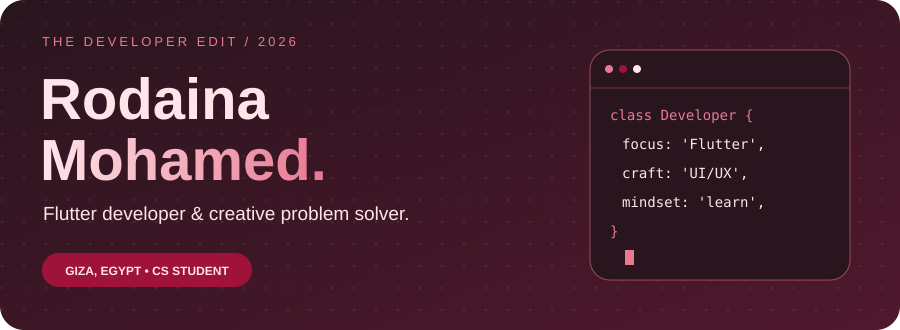
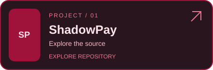
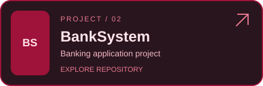
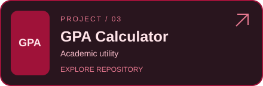
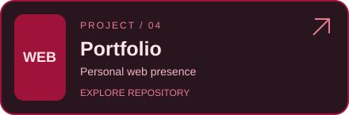

## ✦ Behind the screen

I'm a **Flutter developer** and Computer Science student at **Ain Shams University**. Based in Giza, Egypt, I enjoy bringing ideas to life through thoughtful interfaces, smooth interactions and maintainable code.

`Mobile-first mindset` · `Clean architecture` · `Always learning`

## ✦ Selected work

## ✦ The tools behind my work

**Mobile development**

**Web &amp; development tools**

## ✦ Building better, one commit at a time

**Made of curiosity, creativity &amp; a little bit of code.**

[Explore all repositories ↗](https://github.com/RodainaMohamed9?tab=repositories)

