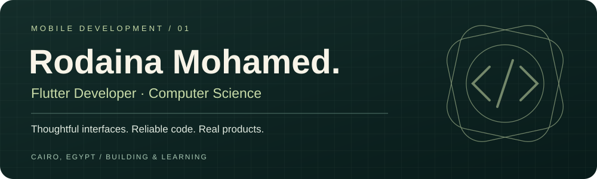

 

## A little about me ✦

I'm a Flutter developer and Computer Science student at Ain Shams University, based in **Giza, Egypt**. I love the intersection of design and engineering: making applications feel as good as they work.

<table>
<tr><td width="50%"><b>✧ What I build</b> Cross-platform mobile apps, responsive interfaces and connected experiences.</td><td width="50%"><b>✧ What I care about</b> Clean architecture, smooth animations, performance and thoughtful details.</td></tr>
</table>

## Featured creations ✦

<table>
<tr><td width="50%"><h3><a href="https://github.com/RodainaMohamed9/ShadowPay">01 / ShadowPay ↗</a></h3>Explore my project and its implementation.  </td><td width="50%"><h3><a href="https://github.com/RodainaMohamed9/BankSystem">02 / BankSystem ↗</a></h3>A banking application project.  </td></tr>
<tr><td><h3><a href="https://github.com/RodainaMohamed9/gpa_calculator">03 / GPA Calculator ↗</a></h3>A practical academic utility.</td><td><h3><a href="https://github.com/RodainaMohamed9/rodaina-portfolio">04 / Portfolio ↗</a></h3>My personal corner of the web.</td></tr>
</table>

## My creative toolkit ✦

**Mobile engineering:** Bloc/Cubit · REST APIs · Reusable widgets · Clean architecture

## A little progress every day ✦

---

**Always curious. Always creating.**

[Explore my repositories ↗](https://github.com/RodainaMohamed9?tab=repositories)

